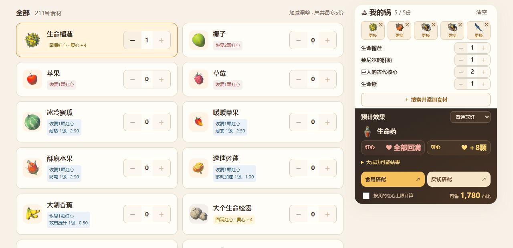
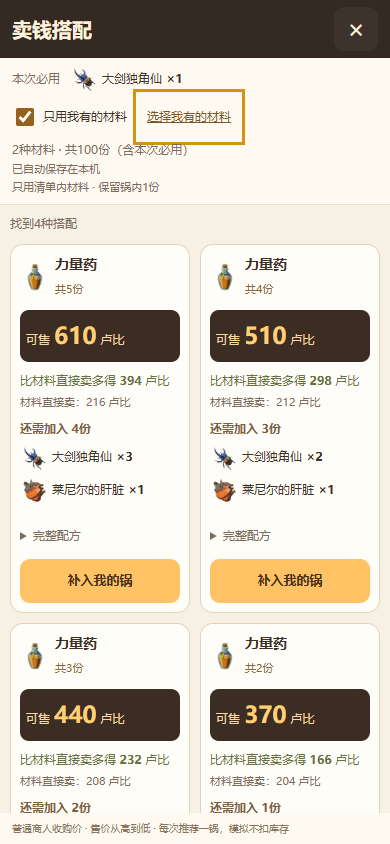

# Zelda: Breath of the Wild Kitchen · 旷野厨房

**塞尔达传说：旷野之息料理与食谱查询 · BOTW Cooking, Elixirs & Rupee Planner**

**See what your ingredients can cook—and compare recipes for eating or selling.**

A fan-made cooking, elixir, and rupee-planning tool for **The Legend of Zelda: Breath of the Wild (BOTW)**. Add up to five ingredients to a virtual cooking pot to preview the result, or look up a dish and try a minimal recipe.

Plan meals and elixirs for Link to recover hearts or stamina, resist cold or heat, and boost attack. When you want more rupees, compare selling combinations using the materials you have.

**[Open the website →](https://zelda.wx-qq.net/)** · [简体中文](README.md) · [Report an issue](https://github.com/Songmanual/zelda-botw-kitchen-showcase/issues/new/choose)

> **BOTW only. Tears of the Kingdom (TOTK) is not supported.** The website currently uses Simplified Chinese. Browser translation may help with navigation, but English ingredient and dish-name search is not currently supported. An English interface is not included in this release.

## What you can do

- **Preview your pot:** see the dish or elixir, hearts, bonus hearts, stamina, effect level, duration, and selling price. Invalid combinations still show their failed cooking result.
- **Find a recipe:** one home-page search box finds ingredients and dish names using Chinese names, aliases, pinyin, and initials. Choose a dish to load a minimal recipe.
- **Get cooking suggestions:** start with an ingredient, then compare additions for useful effects. Sort by fewer additions, stronger effects, or longer duration where applicable.
- **Compare selling options:** keep your starting ingredients and browse combinations by selling price. Select available materials and quantities to limit results to what you have.
- **Use it on your device:** responsive layouts for desktop, tablet, and phone; no account required.

## Quick start

1. Search or browse for an ingredient and add it to the pot.
2. Adjust quantities with the plus/minus buttons and read the result.
3. Open **食用搭配** (cooking suggestions) or **卖钱搭配** (selling combinations), then apply a suggestion. You can undo it.

  

## Scope and limits

- Your material list is saved in the current browser. Refreshing normally preserves it; clearing site data removes it. There is no cross-device synchronization or automatic inventory deduction.
- Selling suggestions keep the ingredients already in your pot and consider one pot of up to five items, showing up to 60 successful combinations under the current constraints. This is not a multi-pot optimizer for your entire inventory.
- Cooking suggestions are checked with the cooking calculator. Suggestions adding three or more distinct materials do not claim exhaustive coverage of every possible combination.
- Critical cooking and Monster Extract can produce random outcomes. Separate maximum values are not necessarily achievable together.
- This tool models cooking-pot recipes, not roasting, freezing, or hot-spring processing.

The rules have automated checks and cross-comparisons, but not every possible combination has been tested in-game. Reports with exact ingredients, quantities, cooking conditions, and game screenshots help us improve accuracy.

## Feedback

[Report a bug or suggest an improvement](https://github.com/Songmanual/zelda-botw-kitchen-showcase/issues/new/choose). English reports are welcome. For display issues, include your device and browser. For calculation issues, include ingredient quantities and whether critical cooking or Monster Extract was involved.

Created by **Solterra** · Contact: **115387@qq.com** · QQ: **115387**

## About this repository

This repository provides the project introduction, website link, and issue tracking. It does not distribute application source code or deployment packages. Screenshots show V0.8.x; the live website may change.

This is an unofficial fan-made tool, not affiliated with, sponsored by, or endorsed by Nintendo. Game names and artwork belong to their respective owners. Game icons were sourced from the community collection [Chalmoro/BotW-Icons](https://github.com/Chalmoro/BotW-Icons). Their inclusion does not grant a license to reuse the artwork. See [NOTICE](NOTICE.md).
